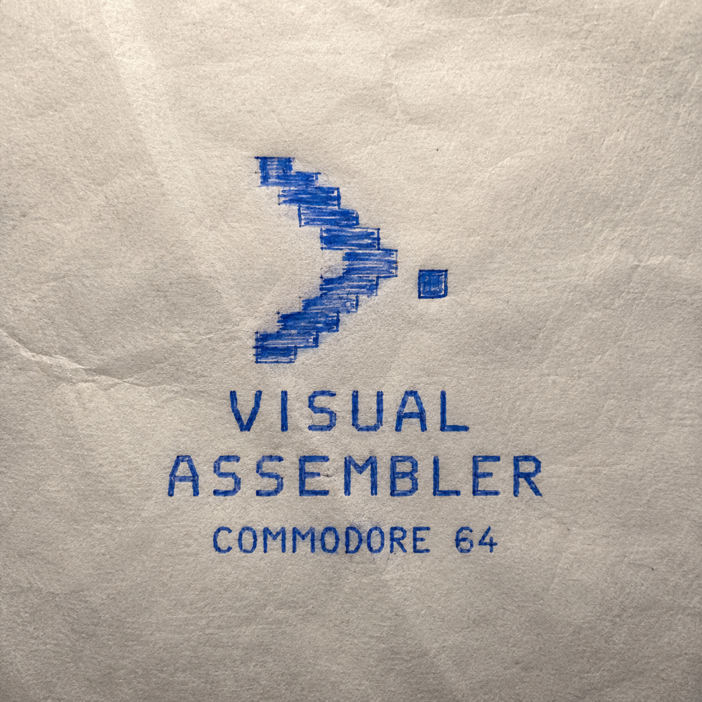

# C64 Visual Assembler

A Tauri 2-based desktop application for visually composing Commodore 64 6502 assembly programs using drag-and-drop blocks. Arrange mnemonics, macros, and labels in a program list and see the generated ASM and monitor output update in real time. Optionally run the program directly in VICE.

**Current version: v2.7.0**

Visual Assembler is free and open source (GPLv3): every feature — editors, builds, hardware runs, languages and themes — works without a registration or serial. At most once a day the app sends an anonymous startup ping (version, OS, UI language, launch count, a random install ID) for the usage statistics; no email, project or source code is sent.

## What's New in v2.7.0

- **Built-in C64** — VICE 3.10 (x64sc, compiled to WebAssembly) now runs inside the app, nothing to install. Choose **Built-in C64** in the Run menu, or open it with its toolbar button. Run builds your program, resets the machine and starts it.
- **Debugger** — it stops before the instruction at a breakpoint; Continue, Break, Step into / over / out; editable registers and flags, disassembly around PC, memory view and breakpoint list. Breakpoints come from the editor, from Block mode and from the disassembly, and the editor follows the CPU. The **Debug** button uses it in this mode, and whenever no RetroDebugger is set.
- **Machine settings** — PAL or NTSC, SID 6581 or 8580, reSID or FastSID, REU up to 16 MB, joystick port, warp and sound.
- **Your own files** — the **Files** menu loads a PRG and attaches a D64 or a cartridge (.crt). The status bar shows the drive LED and track, and a blinking LED shows as a drive error, for example when a file cannot be found.
- **Display** — a CRT filter with scanlines, full screen (button or double click, Esc leaves) and a resizable window. The window and its settings come back on the next start.

## Earlier: v2.6.9

- **Git branches** — the Version control window switches, creates, renames and deletes branches and merges one into the current branch; a merge conflict lists the files, marks them red and offers **Abort merge**. The open tabs reload from disk after a switch, merge or stash.
- **File by file and stash** — every changed file can be staged, unstaged, discarded (an untracked one deleted) and its diff opened with a click; **Stash** puts the changes aside and the stash list applies, pops or drops them. Without *Stage all changes* a project commit takes only the staged files.
- **A better diff** — a card per file with its status and +/− counts, old and new line numbers, assembly / UB syntax colours and the changed part of a line highlighted; **Split** shows old and new side by side, ⤢ gives it more room.
- **Discard changes really discards** — in Git mode it asks first, then resets the files on disk to HEAD (`git restore`) and reloads the tabs, so you can switch branches afterwards; from the menu the result shows as a message.
- **Kick projects** — cycle counts, errors and hints also work in files the startup file does not import (from the file's own tree, e.g. `main.asm` next to a `boot.asm` startup file); a forward branch inside `.pseudopc` (`bne !+`) is relative to the logical address; `s.charAt(i) == '1'` compares as in KickAssembler.
- **Fixes and looks** — *Save project* saves an opened Expert project in place (with its unsaved file tabs) instead of asking for a name; the Version control window stays within the screen and uses icon tool buttons; shorter number fields in the Table Generator.

## Earlier: v2.6.8

- **Toolkit in Expert and UB mode** — the *Toolkit* toolbar button shows the C64 palette and the PETSCII codes next to the editor: in Expert mode as a side panel beside Disassembly / Monitor, in UB mode in the right-hand pane (it takes turns with Disassembly and Monitor).
- **Panels remembered** — the Monitor and Toolkit panels of Expert mode can be resized like the Disassembly; the panels you leave open (Palette, Disassembly, Monitor, Toolkit, Project) and their widths come back on the next start, whichever mode the app starts in — in UB mode too.
- **VMA language** — a `.const` or `.var` in the zero page makes `lda zp` a zero-page instruction (`A5 FB`, as KickAssembler does; `lda.abs zp` keeps absolute); `JMP (label)` / `JMP (table+2)`; expressions such as `lda $1234+1` and `sta $0400+40*2,x`; a macro may call another macro; labels in the bytes of `.data` / `.rawbytes` (pointer tables); a `:name` label may point at a label.
- **Includes** — an included file's own `.include`, `.incbin` and `.sid` lines are loaded (relative to its folder) and its macro calls are expanded; a missing include, or one that includes itself, is an error instead of an empty library.
- **Safer builds** — errors instead of silently wrong code: an unresolved TURBO_SET / SPRITE_ANIM value, a MEMCPY / MEMSET / JOYSTICK size taken from a label defined later; the automatic buffer of a `.data` / `.rawbytes` macro argument takes its bytes. Programs using zero-page constants get shorter.
- **Fixes** — a CRT larger than 8 KB (more than one bank) did not start: the loader now runs from RAM; an `.asm` name given in the Save dialog of a project saves the source text, not the VA JSON.

## Earlier: v2.6.7

- **Rust VMA compiler** — Settings → General → Program → *VMA compiler*: JavaScript (the default), Rust, or *Rust + JavaScript check*, which builds with both and logs any difference. The Rust compiler gives the same bytes, memory view, segments and translated error messages; Kick projects build through it too, with errors at `file:line`.
- **VMA is open source** — the Visual Macro Assembler compiler lives in its own GPLv3 repository, [github.com/zstarczali/VMA](https://github.com/zstarczali/VMA) (version 2.0.0), with an English and a Hungarian language manual and a command-line compiler. The About box shows the VMA version and banner next to Ultimate Basic.
- **Project symbols and constants** — *Project settings* sets VMA symbols (`.define`, for `.if` / `.ifdef`) and constants (`.const`) for the whole project, saved in the `.proj`; error lines stay correct.
- **Compiling dialog** — a step line under the progress bar names the engine, the file and the PRG size.
- **Build info** — shows the file it describes; an ACME source gets its own view from the real ACME build (origin, end, size, segments, labels). It no longer closes on an outside click.
- **Faster typing** — in ACME mode the Disassembly and Monitor panels are rebuilt once per build and dimmed while the source is newer; big Kick projects re-use their last preprocessing and render the disassembly in chunks.
- **Project tree** — *Move up* / *Move down* in the right-click menu of files and folders. Kick compatibility is now switched in *Project settings* (the `{K}` button is gone).
- **Fixes** — saving an `.asm` (Ctrl+S, Menu → Save, before a git commit) writes plain text again, not the VA JSON; version control snapshots keep source files as text; library macros inside a user macro (SET_BORDER, SPRITE_*, JOYSTICK, TEXT …) get their parameters, runtime IF / WHILE / REPEAT labels are unique per call and a `'A'` argument stays a character; draggable dialogs open at their saved place.
- **Look** — the compiling, build info, D64 export, compile error and question dialogs have the About box frame; the manuals are revised.

## Earlier: v2.6.6

- **SID player macro** — `.sid_player [subtune][, raster]` (*SID_PLAYER* in the palette) plays the tune of the `.sid` macro: it calls init with the subtune, switches the CIA1 timer IRQ off, hooks a raster IRQ and calls play every frame from its built-in handler, then continues in the KERNAL (`JMP $EA31`); 58 bytes. Music is now `.sid "music.sid"` + `.sid_player`.
- **SID labels** — the `.sid` macro defines `SID_LOAD`, `SID_INIT` and `SID_PLAY` (moved with a custom load address), so your own IRQ handler can `JSR SID_PLAY`.
- **Expert mode only** — a Project settings switch that closes block mode for the project's files, whatever their size (saved in the `.proj`).
- **SID Player buffer** — Settings → General → SID preview → SID Player buffer: 2048–16384 samples; a larger buffer stops the crackle while the app is busy (WebSID after a restart; VA SID Core renders 10 / 15 / 20 / 30 s ahead).
- **Custom C64 palette** — Settings → General → Editors → *Edit custom palette…*: your own RGB value for each of the 16 colours (colour picker or hex), starting from any built-in palette; import Photoshop `.act`, VICE `.vpl`, GIMP `.gpl` or a hex list, export `.act` / `.vpl`. *Custom* is then a palette like Colodore or Pepto, also in the Hi-Res image import.
- **Look** — the C64 memory panel docks back collapsed; the What's New, update, Settings and Knowledge Base windows have the About box frame; VA switches in Project settings.
- **Fixes** — the bug report accepts PNG / JPG screenshots in the release build; the splash `READY.` cursor is a solid C64 cell (no lines on macOS); macOS inline predictive text is off in the Expert and Ultimate Basic editors.

## Earlier: v2.6.5

- **KickAssembler projects** — *Menu → Program → Import Kick project…* takes a whole KickAssembler source tree (main file, `#import` modules, `.import binary` assets) and writes a `.proj` next to it; the sources stay in place. VA builds it with its own assembler byte for byte like KickAssembler 5.25 (the Dark Chambers C64 port and all eleven KickAssembler examples with code build identically), including segments and output files, `LoadPicture`, `.cpu _65c02` / DTV, `Vector` / `Matrix`, `.break` / `.watch`; Debug gets a source map with the original files and lines, the editor highlights and completes KickAssembler syntax; Run, Build PRG / D64 / CRT, Exomizer, Debug, VICE Monitor and Build project work, errors are `file:line`, the tree is checked while typing.
- **Project settings** — gear button in the Project panel / Menu → File: name, startup file, assembler, Kick compatibility, `#define` symbols and `cmdLineVars`, saved in the `.proj`.
- **Kick-compatible switch** — `{K}` in the Project panel header makes any VMA project KickAssembler compatible (saved in the `.proj`); VA macros keep working.
- **KickAssembler language** — `#import` / `#importonce` / `#importif`, `#define` / `#if`, `.const` / `.label` (zero page by value), `.for`, `.while`, `.if … else`, `.var` / `.eval`, `.function`, `.macro { }`, `.pseudocommand` with argument types, multi-labels, scopes and namespaces (`name.inner`, `.namespace`, `.filenamespace`, `@`), `.pseudopc`, `LoadBinary` (templates), `LoadSid`, `virtual` blocks, `cmdLineVars`, `BasicUpstart2`, `List` / `Hashtable` / `.struct` / strings, `.enum`, math library, colour and opcode constants, `*`, `;`, `.error` / `.errorif`.
- **Build Info in columns** — stat tiles, segments, errors, `.print` output, labels / constants / macros in a grid; Kick projects show the built tree.
- **C64 colour palette** — Settings → General → Editors: Colodore (default, closest to real hardware), Pepto, VICE, Deekay or C64 Wiki / Godot for every editor and the Hi-Res image import.
- **Colour picker** in the Hi-Res, Sprite, Character and Charset Canvas editors (Alt+click with any tool); **Ctrl + wheel zoom** in the Hi-Res, Sprite, Map and Level editors.
- **ACME** — memory map and overlap warning from the ACME build; ACME projects build their startup file; ACME templates only with a working ACME, and an ACME project switches Settings to ACME mode.
- **Fixes** — `.byte` / `.word` label expressions no longer assemble to 0; illegal `NOP #$nn` / `$nn` / `$nn,X` / `$nnnn` / `$nnnn,X`; *New project from template…* under *New project*; *Load .ub file* label in every language.

## Earlier: v2.6.4

- **ACME assembler mode** — Settings → General → Assembler mode: *VMA mode* (the built-in assembler) or *ACME mode*, which builds the Expert source with ACME 0.97 (path in Settings → Files and paths → ACME). Build, Run, Build PRG / D64 / CRT, Build project and Debug use the real ACME output; Disassembly / Monitor, debugger symbols, cycle counts, optimisation hints and the VICE Monitor (hot reload, watch, profiler) follow the ACME build. ACME highlighting and autocomplete, VMA macros in ACME source and ACME `!` directives in VMA source are reported, editor exports are inserted as ACME source, and `.proj` remembers the assembler. Text only: block mode is off and the Tutorials button is hidden in ACME mode.
- **Better Kick Assembler import** — the menu entry is now *Kick import*; plain `.text "…"` with `.encoding` (`screencode_mixed` default, `screencode_upper`, `petscii_mixed`, `petscii_upper`, `ascii`, `@"…"` escapes), PC labels `.label loc = * + 1`, `.abs` / `.zp` mnemonic suffixes. Restore64 disassemblies import and build byte for byte like KickAssembler.
- **Run starts programs below the BASIC line** — a program that loads below or across the BASIC SYS line (e.g. from `$071C`) gets a small loader that moves it into place and jumps to the first ORG; a lower ORG later in the source is no longer moved up.
- **Exomizer** — no more `?SYNTAX ERROR` on the second RUN of a crunched program (`sfx basic` for PRGs with a BASIC line).
- **SID Editor** — playback LCD (position, pattern, row, time; Settings → SID preview → LCD colour green / red), VA-VK instrument knob with an LCD, progress bar for *Import .sid…*.
- **Settings** in three tabs (General, Files and paths, Integrations); **Ctrl+N** opens a new tab; dialog text is no longer selectable by accident; faster editing of large Expert sources; `LSR A` and `JMP ($nnnn)` import fixes; Knowledge Base link to Restore64 (restore64.dev); ACME memory dumps with a segment below `$0801` build at their own addresses with the start loader.

## Earlier: v2.6.3

- **.sid import in the SID Editor** — *Files → Import .sid…* plays a PSID / RSID subtune silently in VA SID Core and converts its SID register stream into instruments, patterns and a song: note ons and legato notes, rows placed exactly on the notes (funktempo / swing via `F` effects), wave / arpeggio tables with fixed-pitch drum attacks, pulse and filter movement, gate timing with hard restart, and vibrato. Up to 128 instruments; identical wave tables are stored once in the player data.
- **Long tunes play correctly** — tune data that does not fit next to the player at `$C000` moves to its own segment below `$A000` instead of running into I/O; the `.sid` (PSID) export follows.
- **VA SID Core preview retriggers notes** — preview frames carry the restarted voices, so a note restarted under a held gate gets a new attack.
- **Ultimate Basic 1.6.6** — `PRINT USING "format"; values`, string comparison (`<` `>` `<=` `>=` in PETSCII order), floating-point `rnd` and `mod`, floating point in IRQ / NMI handlers, `option basic print` (C64 BASIC PRINT spacing), smaller programs (only the floating-point routines in use), 16-bit `mod` and arithmetic `shr` for INTEGER; 1.6.5: 16-bit address expressions in `peek` / `poke` / `fill` / `memcopy`. The UB editor highlights `print using` and `option basic print`.
- **Update server setting** — Settings → Updates sets the server the in-app update reads releases from (default `https://www.c64va.pro/`, installers under `downloads/VA/`; `https://` required).
- **SID Editor** — the header shows the active SID emulation (WebSID / VA SID Core and chip model); the Speed field has − / + buttons and takes 1–255; up to 256 patterns; the BPM label is fixed.

## Earlier: v2.6.2

- **HVSC in the SID Player** — search the High Voltage SID Collection (about 61,000 tunes) by title, composer or folder; play, add to the playlist or save a tune; download the whole collection (the official 7z, unpacked in the app) for offline use or use an unpacked HVSC folder. HVSC tunes get their real subtune length on the seek bar and for auto-advance.
- **Spectrum analyzer** — a floating LED-bar window for the SID Player: 8 / 16 / 24 / 32 log-spaced bands, fading cells, a mirrored floor; works with VA SID Core and WebSID.
- **Lesson Editor** — makes a step-by-step guided lesson (pick the mnemonic, type the operand, Add, set the remaining parameters) from your own Block or Expert program; texts per UI language, any Tutorials folder, try / save, `.vatut` export / import.
- **Online lessons** — lessons published on www.c64va.pro (`lessons/`) are listed in the Tutorials window and downloaded with one click, with updates; your own lessons can be uploaded from the Lesson Editor and appear there after review on the dashboard.
- **One rule for the palette's operand field** — every macro with parameters takes them there, as the text after its Expert keyword (`SET_BG $06`, `REGION Main`, `ORG $C000` …); file macros keep their file picker.
- **Smaller improvements** — the active floating window is highlighted, the Support window looks like a chat, the mouse wheel scrolls the tab bar sideways, the memory bars are separated from their titles, and the Ultimate Basic code size column no longer covers the line numbers.

## Earlier: v2.6.1

- **VICE Monitor** — a floating window for the running VICE (Run (VICE) now opens its binary monitor on port 6502): hot reload the assembled program with or without a restart (optionally after every edit), a live watch list of labels and addresses, and a PC-sampling profiler per routine and per line with the raster lines each routine ran on.
- **Table Generator** — screen / bitmap row addresses, bitmap column offsets, pixel masks, multiply / divide / remainder by a constant, quarter squares, reciprocal, log / exp, bit reverse, custom expressions and unrolled fill / copy speedcode; lo / hi pairs or `.word`, `.align 256`, insert, `.bin` or Ultimate Basic export.
- **Cycle counts in Expert mode** — cycles per instruction (`4+` page cross, `2/3` branches, red `2/4` for a page-crossing taken branch) and the cycle / raster-line total of the selection.
- **Optimisation hints** — tail call, redundant `CMP #0`, reloads, `INC` / `DEC` idioms, jumps to the next instruction, `PHA` + `PLA`.
- **Zero page usage map** in the memory panel, with SID player conflicts; the **memory panel can be detached** into its own window, and the clicked floating window comes to the front.
- **Ultimate Basic** — code size per line, hints (`sys $EA31`, `wait key`, unused variables, `asm` zero page clashes) and Sprite Editor → Ultimate Basic export with animation.
- **SID Editor → .sid (PSID) export** and a **sprite multiplexer** project template (16 sprites).

## Earlier: v2.6.0

- **Visual Assembler is now completely free** — the Freemium / Professional licensing has been removed. Every editor, build and hardware run option, all 7 UI languages and every theme work for everyone, without registration or a serial. The reason is simple: under Hungarian tax rules, selling the program would leave too little after taxes and paperwork to be worth it. Serials you already have are simply no longer needed.

## Earlier: v2.5.9

- **Commodore 64 theme** — the C64 power-on screen: a light blue border around blue panels, light blue text, reverse-video buttons, syntax colours from the C64 palette and the C64 font in the monitor view.
- **Commodore Beige theme** — the classic breadbin: a beige case, mustard function-key buttons, the rainbow badge stripes and a C64 blue screen for the monitor view.
- **Commodore Starlight theme** — a light theme after the translucent C64 breadbin: frosted clear glass with the rainbow RGB glow shining through, a magenta accent, rainbow syntax colours and a smoky dark monitor.
- **Version control dialog** — drag it by its header; it reopens where you left it, stays on screen when the log or a diff makes it taller, and a click outside no longer closes it (Esc does).

## Earlier: v2.5.8

- **Version control** — the project snapshots became a git-like version control: commits with a message and a short hash, a log with **HEAD**, **Diff** against the working copy (Block-mode programs are compared as assembly lines, so JSON projects show readable changes), **Checkout** into the editor and separate autosave entries (the last 20 are kept, next to up to 100 commits). Works on Block, Expert and Ultimate Basic tabs.
- **Git integration** — choose `git.exe` in **Settings → Version control** or let the app find it on the PATH. Inside a git repository the dialog shows the branch with ahead / behind counts and the changed files, and offers commit (saves the file first; optionally `git add -A`), the file's log, diff (parsed, with a **RAW** view of the plain `git diff`), checkout into the editor (`git show`), **Pull** (`--ff-only`), **Push** (sets the upstream on the first push) and **git init**. git runs without a console window and without prompts.
- **Report Bug** — **Menu → Report Bug** opens a form: summary, description, optional email, up to 4 screenshots (file, **Ctrl+V** or drag and drop; large images are scaled to 1920 px), and optionally the system info and the last app errors. Reports go to the developer's dashboard; **Send by email** is still there.
- **SID Player** — **Shuffle** (no repeats until every tune has played, Previous steps back along the random order) and per-tune **favourites** (★), kept in the saved state and in `.sidpl` playlists.

## Earlier: v2.5.7

- **VA SID Core 1.2** — the SID Player now includes a native Rust C64 core: a cycle-exact 6510 (every bus cycle including dummy reads / writes and BA stalls), the CIA 6526 / 6526A (timer pipelines, interrupt flag delay line, timer B bug, PB6 / PB7, shift register, TOD), VIC-II timing (raster counter, raster interrupt, bad lines, sprite DMA with Y expansion and crunch) and the 6510 I/O port with its floating bits.
- **Hi-Res Editor: two colours per 8×8 cell** — the new **Cell paper** tool sets each cell's background (the low nibble of its screen RAM byte), so every cell has its own ink and paper as on the C64; the eraser uncovers the cell's own background. Disabled in multicolor, which has one shared background.
- **Exact character ROM** — the ROM viewer, **Load ROM** in the Character Editor and the Map / Level editors draw the real glyphs from the font's PETSCII code points, checked byte by byte against the 901225-01 character ROM (both sets, reversed characters included); several graphics characters were wrong or missing.
- **Sprite Editor** — a **hi-res overlay** sprite over every frame (an outline over a multicolor body, saved and copied after the body's sprites); **flood fill**, **select / move** (arrow keys, Delete, Esc) and **rotate 90°**, all acting on body and overlay together; **Mirror all** appends a mirrored copy of the animation; **sprite sheet import** (cell size, offset, gap, OKLab colour matching, Bayer or Floyd–Steinberg dithering); a **hitbox** per frame with **Copy hitbox table**; an **X / Y ×2** expansion preview; zoom up to 40×.
- **Level Editor** — an **objects layer** (start, enemy, item, door, exit, trigger with a parameter byte, exported in scroll order as `LEVEL_OBJ_*` tables); **character attributes** (solid, ladder, hazard, collectible → the 256-byte `LEVEL_ATTR` table); an **edge check** that marks screen borders that do not continue; **colours per screen** (`LEVEL_SCR_BG / _BORDER / _MC1 / _MC2`); a **memory meter** for the `.level` data with RLE export and a 6502 unpacker; **Run in VICE** builds a joystick-scrolled test program from the level.

## Earlier: v2.5.6

- **SID Player** — a new toolbar button opens a floating player for `.sid` (PSID / RSID) tunes: a playlist with drag and drop, previous / next tune, subtune switching, seek and ±10 s (VA SID Core), a volume knob shared with the SID Editor, and playlist save / open as `.sidpl` with the tunes embedded. The list, the current tune and the window state are remembered.
- **VA SID Core 1.1** — the app's own SID emulation in Rust: MOS 6581 / 8580 with a MOS 6581/8580-based 6581 filter and mixer, two-stage FIR resampling and SID bus reads, plus a cycle-locked PSID / RSID pipeline (6510 CPU, CIA / VIC timing, IRQ handling, the KERNAL `$EA7B` IRQ tail), so raster-IRQ and digi tunes play. Choose WebSID or VA SID Core (and the chip) in **Settings → SID preview**; the player shows the active engine.
- **SID Editor** — all instrument parameters are knobs; the ADSR graph uses the free width; **MIDI input** (choose the device, **Connect MIDI**, an activity lamp); **recording** into the tracker from VA-VK, the computer keyboard or MIDI, in time with the Speed — when the pattern is full a new one is added to the song; a **metronome** with beat lamps on the tracker and on VA-VK; **pattern delete** with song renumbering; the master volume knob on VA-VK; the filter controls in two columns.
- **Import GoatTracker .sng** — **Files → Import GoatTracker .sng…** converts a GoatTracker 2 song (GTS3–GTS5): the per-voice order lists are flattened into 32-row patterns, instruments and their wave / pulse / filter / speed tables become editor instruments, key off / portamento / tempo become note-off / `U` / `D` / `F`; a message lists what was approximated.
- **Ultimate Basic 1.6.4** bundled.

## Earlier: v2.5.5

- **Hi-Res Editor: pixel grid** — with **Grid** on, from 4× zoom every pixel gets its own grid line, stronger on the character-cell borders (8×8 pixels in hi-res, 4×8 double-wide pixels in multicolor). The lines are part of the picture buffer, so drawing stays as fast as without the grid, and each line is shaded from the colour under it — darker on light colours, lighter on dark ones — so it shows on all 16 C64 colours.
- **Hi-Res Editor: 16× zoom** — the zoom slider now goes from 1× to 16× (was 8×).
- **Right-click Copy / Paste menu** — on the canvas of the **Hi-Res Editor** and the **Map Editor**: Copy, Paste and Transparent paste; in the **Sprite Editor** (canvas and frame strip): Copy frame and Paste frame. Entries that cannot be used are greyed out, a paste started from the menu previews where you clicked, and the three new labels are translated in all seven UI languages.
- **Number Converter** — its toolbar button is a toggle now: it stays highlighted while the converter is shown.
- **Fixed** — the multicolor cell grid of the Hi-Res Editor was drawn twice as wide as a character cell; the Hi-Res toolbar **Paste** button always pasted transparently (only `Ctrl/Cmd+V` pasted normally); the SID Editor right-click menu opened away from the cursor while the dialog was centred.
- **Manual** — the Hi-Res / Multicolor Editor chapter now documents selection, copy / paste and transparent paste, which were missing.

## Earlier: v2.5.4

- **Fixed: window not appearing on relaunch** — if the app was quit while its window was minimized, hidden or on another Space (mostly macOS, also Linux / Wayland), the saved window state restored it as hidden and the next start came up without a window. The visible state is no longer saved (the window size still is), the window is shown after the first paint, and a startup fallback shows it after 3 seconds if it is still hidden.
- **Ultimate Basic 1.6.3 bundled** — QBasic-style syntax next to the unchanged `var` / `sub` / `fn` / `end` forms. Declarations: `DIM name AS type [= value]` and `DIM name(u1, u2, …) AS type` arrays of every type (byte, integer, single / double, string) with any number of dimensions; `FUNCTION … END FUNCTION` and `SUB … END SUB` with `AS` types, return by assigning to the function name, sub calls without parentheses. Control flow: `ELSEIF`, single-line `IF … THEN … ELSE …`, `DO [WHILE|UNTIL c] … LOOP [WHILE|UNTIL c]`, `WHILE … WEND`, `SELECT CASE` (value lists, `lo TO hi`, `IS > n`, `CASE ELSE`), `EXIT DO` / `EXIT FOR` / `EXIT WHILE` / `EXIT SUB` / `EXIT FUNCTION`, `END IF` / `END SELECT`, a lone `END` ends the program, `'` comments, `PRINT a; b; c`. Runtime strings: `s = a + b`, `LEFT$` / `RIGHT$` / `MID$`, string `=` / `<>`, 16-bit `STR$` / `VAL`. `INTEGER` is signed 16-bit (`WORD` stays unsigned), and `INPUT` reads `INTEGER` / `WORD`, `DOUBLE` and array elements.
- **UB editor** — the new keywords, the string functions and `'` comments are highlighted; context words are coloured only where they act as keywords (`as` + type, `case is`, `map view`, `wait key`, `scroll row | x | y … left | right | narrow | wide`). Autocomplete offers the new words, Format indents `function`, `do … loop`, `while … wend` and `elseif` and leaves one-line loops alone, the Project panel lists `function` blocks, and the Commands panel has new **DIM**, **FUNCTION**, **ELSEIF**, **DO**, **WEND**, **SELECT CASE**, **END**, **EXIT SUB**, **LEFT$**, **RIGHT$** and **MID$** entries in all seven UI languages.

## Earlier: v2.5.3

- **Fixed: running in VICE on Windows** — VICE, RetroDebugger and D64 runs failed with *program not found* when PowerShell was missing from PATH. PowerShell is now called by its full path, and the program is started directly if that fails. VICE starts from its own folder (a linked `x64sc.exe`, e.g. from winget, is resolved to the real one), and paths with spaces are quoted.
- **Knowledge Base** — new link to the VICE emulator homepage.

## Earlier: v2.5.2

- **SID Editor previews on the real SID** — the instrument **Preview**, the virtual keyboard, note entry, chord and arpeggio previews, row preview and single-pattern playback now play through the WebSid emulator, not a synthesizer. A small stream player copies the SID registers that the JS engine (the frame-exact model of the exported player) writes every frame; up to three notes share the three voices. It is preloaded when the editor opens and after Stop, so notes sound at once. Without WebSid the small synthesizer remains as a fallback.
- **Note-off in the tracker** — key **1** (or typing `===` / `OFF`) writes a note-off: the gate is released and the instrument's release runs. As in other trackers, a note otherwise sustains until the next note on its voice. **Enter** edits the selected cell as text.
- **Detachable tracker** — a toolbar button moves the song, tracker and harmony rows with the grid into a floating, resizable panel (and back), so a long wave table leaves the tracker room; position, size and state are remembered.
- **Wave / arpeggio presets** — the preset list keeps showing the chosen preset (per instrument) until the table is edited by hand.
- **VA-VK** — the virtual keyboard has a new name on its Commodore 64 brand bar, **Play / Stop** buttons, and remembers its position, open state, octave and *Insert into tracker*. The SID editor's **master volume** is remembered.
- **Knowledge Base** — new links: C64 OS development environment and the png2c64 image converter; the list is shown in two columns.

## Earlier: v2.5.1

- **SID Editor instruments like a real tracker** — every instrument now has:
  - **Filter:** *Route this voice through the filter*, **3 OFF**, and a cutoff **sweep** from Cut toward End by Sweep per frame, optionally **ping-pong** — resonant filter sweeps. The voice that starts a filter-routed instrument owns the filter; routing is per voice.
  - **Vibrato:** delay, speed and depth (scaled to the note's semitone), independent of the `V` effect.
  - **Pulse width modulation:** speed per frame, bouncing between min and max.
  - **Gate:** gate timer and **hard restart** before the next note, and the waveform of a note's first frame (e.g. `$09`).
  - **Wave / arpeggio table:** up to 32 steps of waveform and note (relative or absolute), speed and loop, with 25 presets: arpeggios (major, minor, 7th chords, sus4, diminished, augmented, power chord, octave, trill), drums (kick, snare, tom, clap, closed / open hi-hat), lead and bass attacks, and sound effects (laser, pickup, explosion).
  - **RING** and **SYNC** next to the waveforms.
- **New SID player** — the exported 6502 player runs all of this every frame (`JSR sid_frame` from your own IRQ, less zero page, state in `sid_state`). The preview plays the same player model (since 2.5.2 on the real SID through WebSid), so edits are heard while playing and the row highlight follows `F` speed changes, also with WebSid. `.bin` saves keep instrument names and the speed; older saves still load.
- **Virtual keyboard** — 2, 3 or 4 octaves (remembered) in a Commodore 64 synth look.
- **Ultimate Basic 1.6.2 bundled** — `tune` blocks gain `imod`, `ifilt`, `igate` and `itab` lines with the same player algorithm; **Export to UltimateBasic** writes them, and the UB command reference lists them.
- **Bookmarks and Go to line** in the Expert and Ultimate Basic editors — **Ctrl+F2** toggles (or Ctrl+click a line number), **F2** / **Shift+F2** jump, **Ctrl+G** goes to a line; toolbar buttons too. Bookmarks move with edited lines and are remembered per file.
- **Fixed: label expressions in the installed app** — `.assert`, `LEVEL_MULTICOLOR*16`, `*`-expressions and `.level_row` operands failed in the release build (its CSP blocks `eval`); expressions are now evaluated without `eval`.
- **D64 Editor** — the Add program, Open and New dialogs open in the active mode's working folder.
- **Build project** — the report shows where the files were written.

## Earlier: v2.5.0

- **Level Editor** — a new toolbar editor next to the Map Editor arranges Map Editor screens **vertically, horizontally or in a 2D grid** into one level. Add screens from the Map Editor or from map `.bin` files, drag them onto slots, duplicate, reorder, edit them back in the Map Editor, with undo/redo. The preview scrolls through the whole level (drag, arrow keys, or **Play** with direction, speed and loop). **Files** saves the level project (`.bin`), the full level Screen RAM or Screen + Color RAM, exports blocks or copies the asm.
- **New LEVEL / LEVEL_ROW macros** — `.level "level.bin"[, $4000]` places only the placed screens of a Level Editor project (2000 bytes each, identical and empty screens shared) plus row/column/slot pointer tables, and defines `LEVEL_*` labels and constants (`LEVEL_COLS`, `LEVEL_MAX_X`, `LEVEL_BG`, `LEVEL_END` …); max 7 × 10 screens, 0 bytes of code. `.level_row dst, col[, color]` copies one 40-character level row (row in X, start column in `col`) to the address held in the `dst` pointer — screen codes, or with `color` the colors — across a screen boundary, ~14 cycles per byte (132 bytes).
- **JOYSTICK variable mode** — `.joystick port, vx, vy[, fire]` writes the direction into variables (−1 / 0 / +1, `fire` = 1 while pressed) instead of moving a sprite — for a camera, a player or menus. Port `3` reads both joystick ports at once.
- **Level scroll demo** — `samples/level-demo.asm` scrolls a 2×5-screen level pixel by pixel in every direction with the joystick: XSCROLL/YSCROLL, two screen buffers, the next char row/column built two frames ahead and color RAM copied in two halves around the raster beam — smooth and tear-free, with all sprites, `$2000-$3FFF` and a per-frame `game_frame` hook left free for a game.
- **Number converter** — a new toolbar button opens a **non-modal** DEC / HEX / BIN converter: type into any field (`$`, `0x`, `%`, `0b` prefixes, negative decimals as two's complement), 8 / 16-bit width, clickable bits, signed value and low/high byte, copy buttons with prefix. It can stay open while you edit, remembers its value and position, and reopens after a restart if it was open.
- **Examples dialog** — **Menu → Examples…** replaces the sample drop-down with a dialog: the built-in examples grouped by topic, a search box, keyboard navigation, double-click or Enter to load.
- **Ultimate Basic 1.6.1 bundled** — `map load "level.bin"[, addr]` reads a Level Editor project directly (composed into one map) and can place the map data at a fixed address; the new **`map view px, py`** shows the map at a pixel position with smooth, tear-free scrolling in every direction (example: `level_scroll_demo.ub`). Fix: a byte product inside a 16-bit sum (`py = cy * 8 + fy`) is no longer truncated to 8 bits. The UB command reference has a `map view` entry, the `map` description no longer mentions `.ubmap`, and the reference search lists command-name matches first (searching *map* no longer finds every command that mentions a bitmap).

## Earlier: v2.4.9

- **Project templates** — **Menu → File → New project from template…**, or the new toolbar button between **Menu** and **Tutorials**, creates a ready-to-build `.proj` project in its own folder. The dialog has an **Assembler** section (empty program, game skeleton, hires and multicolor bitmap) and an **UltimateBasic** section (empty program, game skeleton, hires bitmap, raster IRQ) with a syntax-highlighted preview. Drop your own `.asm` / `.ub` files into the user templates folder to add templates; a `; @name …` / `# @name …` comment header names and sorts them.
- **Build project** — **Menu → Build → Build project** compiles every buildable file of the open project (or of the open tabs) to a `.prg` next to its source, writes debugger symbol files where available, skips include-only modules and shows a per-file report.
- **Ctrl + mouse wheel zoom** in the Expert and Ultimate Basic editors (`Cmd` + wheel on macOS, touchpad pinch too).
- **Workspaces remember projects** — the Expert and Ultimate Basic project trees, the startup file and unsaved project changes are saved into the `.vaws` workspace and restored with it.
- **Ultimate Basic** — the bundled compiler generates faster, smaller 6502 code, and the memory map tells real code and data apart from padding and long `org` gaps.
- **File dialogs start in the active working folder** (Block/Expert or Ultimate Basic, depending on the mode).

## Earlier: v2.4.8

- **New KOALA macro** — `.koala "picture.koa"` (optionally `, $2000`) loads a Koala Painter picture and shows it. The picture data is placed at `$6000` (Koala native, VIC bank 1) or `$2000` (VIC bank 0) with the file's load address stripped, and the block compiles to an 86-byte display routine: it copies screen and color RAM, sets the background colour, selects the VIC bank and switches on multicolor bitmap mode. Available in the block palette next to INCBIN, with its own description, syntax hint and validation (address and file size).
- **Koala import/export in the Hires editor** — **Files → Import Koala (.koa)…** / **Export Koala (.koa)…**. Export writes the standard 10003-byte file (`$6000` load address, bitmap, screen RAM, color RAM, background); a hi-res picture is reduced to multicolor on export. Import accepts files with or without the load address; `.koa` / `.kla` are also recognised by **Import image / .bin**.
- **Update status in the Expert status bar** — the same *Up to date* / clickable *Update available* indicator as in Ultimate Basic mode.
- **Save dialogs offer the file's own type** — e.g. *KOA (\*.koa)* instead of *Binary (\*.bin)*.
- **Ultimate Basic 1.5.9 bundled** — new **`chain "FILE" [, device]`** loads another program over the running one and RUNs it (boot / title programs); `load "FILE"` now loads to the file's own address and `load "FILE", addr` to `addr` (the secondary address was swapped); `--d64` directory entries, BAM offsets and sector allocation fixed. `chain` is highlighted in the UB editor and listed in the command reference (together with the `sprhit()` / `sprbghit()` short forms).
- **More robust update check** — c64va.pro now publishes the installer list at `downloads/VA/`, so the check works with the new download page (also for 2.4.6 / 2.4.7); the Linux update helper no longer inherits the AppImage library paths.

## Earlier: v2.4.7

- **In-app updates** — **Menu → Check for Update** now checks c64va.pro for a newer release, and on confirmation downloads the installer for your platform (with a progress bar) and installs it: the Windows installer runs in passive mode and restarts the app, on macOS the app bundle is replaced from the DMG, and on Linux the AppImage is swapped or the `.deb`/`.rpm` is installed via `pkexec`. The check also runs quietly at every start; **Skip this version** silences a release you don't want.
- **Update status in the Ultimate Basic status bar** — shows **Up to date (vX)**, or a highlighted **Update available: vY** that opens the update dialog when clicked.
- **Curve Editor → UltimateBasic export** — **Files → Export to UltimateBasic** writes the table as an initialised UB array (`var name = array(N)` / `array_word(N)` for 16-bit, followed by `data name: …` lines). **Files → Export UltimateBasic demo** produces a ready-to-run sprite demo: a ball sprite follows the curve (8-bit tables drive sprite Y, 16-bit 0..320 tables drive sprite X). Both are inserted at the UB editor cursor, or copied to the clipboard outside UB mode.
- **Ultimate Basic 1.5.8 bundled** — new **`data <array>: v, …`** form fills a declared array at program start (several lines continue where the previous one stopped, word arrays take 16-bit values) without touching the `read` stream.
- **Layout fits the window** — the editor panels now take exactly the remaining window height, so the app no longer shows a page-level vertical scrollbar; the ASM output panel can no longer be squeezed below 440 px; the working-folder path sits in a subtle badge above the ASM view title and uses the same badge style in the Expert and Ultimate Basic toolbars.
- **Ultimate Basic command reference** — `tune` and `music` now show full, commented examples (cell format, effects, player notes, `music play N`), `inst`, `order`, `pat` and the tune `speed` have their own entries, `data` shows the new array form, and the `load sid` syntax is corrected (`load sid "tune.sid", $2000`).
- **Dialog buttons** no longer break their labels onto two lines.

## Earlier: v2.4.6

- **SID Editor → UltimateBasic export** — **Files → Export to UltimateBasic** writes the tune as a `tune ... end` block (instruments, order list and pattern rows as text) followed by `music play`, and inserts it at the cursor of the Ultimate Basic editor (outside UB mode it is copied to the clipboard). The UltimateBasic compiler builds a zero-page-free player from it at compile time, so `music play` / `music stop` control the tune and nothing collides with UB variables. Vibrato, slide, note-cut and speed effects are supported; up to 8 patterns, any order-list length. Requires an UltimateBasic compiler with `tune` support.
- **Ultimate Basic language update** — syntax highlighting and the command reference now cover **`sfx`** (non-blocking SID effect: `sfx channel, freq, frames [, wave]`), **`org`** (continue sub/fn code at an address, leaving a zero-filled gap that can hold `incbin` data), **`charset on` / `charset off`** (switch the VIC-II to the RAM character set and back) and **`incbin` slicing** (`incbin "font.prg", $3C00, 2` skips the first bytes, an optional fourth argument limits the length).
- **Multi-block highlight in the ASM view** — selecting several blocks highlights all of their ASM lines at once, the scroll position stays stable while you select, and the line numbers are softer with a subtle vertical separator rule.
- **Assembler mode preserved across Ultimate Basic switches** — opening a project or a built-in sample while Ultimate Basic is active now leaves UB first and returns to your last Block/Expert mode, so the UB buffer can no longer overwrite the new tab's mode or title. New tabs are created in the correct mode.
- **Kung Fu Flash 2 settings** — a **Detect USB** button in Hardware Settings re-scans for the cartridge's serial port, and the KFF2 prerequisites now state the required Kung Fu Flash firmware (v2.07+).

## Earlier: v2.4.5

- **Kung Fu Flash 2 support — run your programs on a real Commodore 64/128.** A new **Kung Fu Flash 2** entry in the split Run menu compiles the program and uploads it over USB straight into a powered-on C64/C128 fitted with a Kung Fu Flash 2 cartridge — no disk image, no SD-card copying, no emulator. The cartridge's USB serial port is auto-detected (Hardware Settings → Kung Fu Flash 2, or type it in by hand: `COM4`, `/dev/ttyACM0`, `/dev/cu.usbmodem…`), and the mode works from Block, Expert and Ultimate Basic mode.
- **Resizable Program / ASM panels** — drag the thin vertical splitter between the Program panel and the ASM output; arrow keys nudge it, double-click resets it to 50/50, and the position is remembered.
- **Cleaner ASM view** — macro blocks are listed without the leading `;` comment marker and coloured as macros.
- **Custom macro highlighting in Expert mode** — macro names after `.macro` / `.invoke` / `.call` (and Kick-style `:name()` calls), the `{param}` substitutions and the `.macro` header parameters each get their own colour in every theme.
- **Refreshed About dialog** — wider two-column layout with grouped links, and the Ultimate Basic banner now has a transparent background.
- **Web64 section** on the product site and an updated `macro-with-parameter` sample using the `.macro setColor(color)` form.

## Earlier: v2.4.3

- **SID Editor effect column** — every tracker cell can carry an effect alongside its note: vibrato (`V`), slide up/down (`U`/`D`), note-cut (`C`), and speed-change (`F`), played back correctly both in the Web Audio preview and the compiled 6502 export.
- **SID Editor song/order list** — arrange and repeat patterns into a full song instead of a single loop; older saves keep loading correctly.
- **D64 Editor explicit Save workflow** — edits (add/extract/rename/delete, and Block Editor byte edits) now land on a working copy with an explicit Save (automatic backup included) and unsaved-change prompts.
- **Improved Block Editor** — the raw byte view is now a per-byte hex grid, and its dialog no longer dims the rest of the app.

## Earlier: v2.4.2

- **Drag & drop onto the D64 Editor** — drop a compiled `.prg`/`.bin` file (from the SID/sprite/char editors' exports, or anywhere else) straight onto the disk image; the Add panel opens pre-filled. Dropping several files at once queues them one after another.
- **Generate include file** — a new toolbar button writes a `.inc` file listing `.const NAME = $ADDR` for every entry on the disk, so the main program can reference where each one landed without retyping addresses by hand.
- **Block editor** — a toolbar toggle switches the D64 Editor to raw track/sector access below the directory: a clickable block map (colored by the BAM's free/used bitmap, with the BAM and directory chain marked separately), a hex view/editor for the selected 256-byte block, and Prev/Next sector navigation. Reads and writes the disk image directly, independent of `c1541`.

## Earlier: v2.4.1

- **Polish and Italian UI languages** — full UI translation (menus, dialogs, mnemonic descriptions, Ultimate Basic command reference) alongside the existing Hungarian, English, Spanish, German and Dutch.
- **Online Help toolbar button** — a new icon button after Debug opens the multi-language documentation site (c64va.pro/docs.html) directly from the app.
- **Centralized mnemonic descriptions** — per-language mnemonic descriptions moved from `app.js` into `i18n.js` alongside the rest of the UI strings, simplifying the language-selection logic. Also fixes a longstanding bug where the English descriptions for `PRINT`, `PRINT_HEX`, `CLEAR_SCREEN`, `WAIT_KEY`, `SET_BORDER`, `SET_BG`, `IRQ_SETUP` and `RAND` were silently overwritten by leftover Spanish text.

## Earlier: v2.4.0

- **D64 Editor** — a full disk-image browser on the toolbar (after the Curve Editor). Open an existing `.d64`, create a new blank one, or launch the current disk in VICE from a Files ▾ menu matching the other visual editors.
- **Add / extract / rename / delete on the D64 Editor** — add a local file to the disk directory, extract a selected entry to `.prg`, rename an entry inline, or delete it — every action is applied straight to the `.d64` via `c1541`, no separate save step.
- **Load address, decompress address & Exomizer in the D64 Editor** — adding a headerless raw file lets you set an optional load address, an Exomizer decompress target, and compress it on the way in, using the same `mem`/`sfx` crunch modes as the Export to D64 dialog. A `.prg` that already carries its own header skips these fields.
- **Disk entry type selector** — choose PRG / SEQ / USR / REL for a newly added file instead of always writing PRG.
- **Authentic directory listing** — the D64 Editor's file list renders in the bundled C64 Pro font, uppercase, for the classic `LOAD"$",8` look.
- **Fixed D64 Editor rename losing focus** — clicking into the rename text field no longer immediately discards the edit.
- **Light theme mode badge** — the BLOCK MODE / EXPERT MODE toolbar badge is darker and more legible in light theme, and its shimmer animation is visible again.
- **Toolbar organization** — added separators around the Tutorials button and after the new D64 Editor icon.

## Earlier: v2.3.9

- **`*` in any expression** — the program-counter symbol now works inside operand expressions, not just alone: `BNE *-5`, `JMP *+20`, `LDA #<*`, `LDA #>(*+63)`. A `*` that follows a value (`STRIDE*2`) is still multiplication.
- **Local (dotted) labels** — a label like `.loop` is scoped to the nearest preceding global label, so `DrawSprite` and `ClearScreen` can each define their own `.loop` without a clash. Reference it as `.loop` in scope or `ClearScreen.loop` from elsewhere.
- **Long-branch pseudo-ops** — `LBNE` / `LBEQ` / `LBCC` / `LBCS` / `LBMI` / `LBPL` / `LBVC` / `LBVS` assemble to an inverted branch over a `JMP` (5 bytes) so the target can be any distance away.
- **`.assert` directive** — `.assert end - start <= 256` or `.assert * < $A000, "message"` is evaluated at assembly time and fails the build with the offending value when false.
- **Self-modifying-code labels** — `LDA value:#$00` makes `value` point at the operand byte, so `STA value` patches it directly; no more `instruction+1` labels.
- **Friendlier branch-range errors** — an out-of-range branch now reports the exact overshoot and suggests the matching `LBxx` long branch.

## Earlier: v2.3.8

- **Workspace save / open** — save the exact set of open file-backed tabs, the active tab and each tab's editor mode (Block/Expert/Ultimate Basic) to a `.vaws` workspace file. Workspaces auto-save on change, and the app auto-restores your last workspace on launch.
- **Global memory panel toggle** — show or hide the full C64 memory panel from a dedicated UI switch.
- **Localized Ultimate Basic command reference** — command descriptions in the autocomplete popup and the Commands panel now follow the current UI language (Hungarian, English, Spanish, German, Dutch), with English fallback.
- **Refreshed Ultimate Basic graphics docs** — `COLOR PEN` and the plot/line/rect/circle and multicolor drawing command help text now match current compiler behavior.
- **Fixed KERNAL reference** — corrected the `SETLFS` and `PLOT` entries (addresses and calling conventions) in the disassembler's KERNAL address table.
- **Fixed memory usage with many tabs open** — per-tab undo/redo history is now capped (with a small debounce), preventing the unbounded memory growth that a long session with many open documents used to cause.
- **Editor toolbar cleanup** — removed the redundant breakpoint toggle buttons from the Expert and Ultimate Basic toolbars (breakpoints are still set from the line-number gutter), and aligned the Expert toolbar height with the Ultimate Basic toolbar.

## Earlier: v2.3.7

- **Undo / Redo and multi-block editing** — toolbar history controls restore block-program changes per tab. Select ranges or multiple blocks, then copy, cut, paste, duplicate or delete them as one operation; region groups remain intact.
- **Breakpoints in Block, Expert and Ultimate Basic modes** — set breakpoints from block cards or editor line-number gutters. Breakpoints are stored per tab and resolved to exact executable addresses.
- **External RetroDebugger integration** — the external debugger replaces the limited embedded UB debugger; all three modes launch with source maps, labels and breakpoint files. Running instances receive tasks through `-pass`; BASIC SYS PRGs use `-autojmp`, while plain PRGs use their real load address with `-jmp`.
- **BASIC stub visibility** — a new VA-style setting shows the real `$0801` BASIC SYS stub in Disassembler and Monitor output in all three modes.
- **Ultimate Basic Monitor view** — inspect compiler-generated code and the optional BASIC stub as a non-wrapping memory dump beside the UB editor.
- **Correct debugger/disassembler origins and labels** — PRG-header load addresses, project startup-file context and `.dbg` / `.sym` / VICE labels now stay aligned with generated code.
- **Editor alignment fixes** — UB formatting preserves selections, caret tracking works across blank lines, held cursor keys and minimap boundaries, UB line numbers no longer clip, and Expert line numbers no longer drift vertically from source rows.

## Earlier: v2.3.6

- **Build CRT (Magic Desk 64K cartridge)** — export the current program as a `.crt` cartridge image (type 19). A tiny loader in bank 0 copies the payload from cart ROM into RAM and jumps to the entry point, so programs run unchanged on VICE, TheC64, EasyFlash, Kung Fu Flash and the 1541 Ultimate II+ / Ultimate 64 cartridge slot. Works in block mode, Expert mode and Ultimate Basic mode. Max payload: 65 408 bytes across 8 × 8 KB banks. Exomizer is bypassed for CRT builds.
- **Build CRT menu entry** — a dedicated *Build CRT* button next to *Build PRG* / *Build D64* in the Menu → Build section, with localization for HU / EN / ES / DE.
- **`//` line comments in the Expert editor** — alongside `;`, you can now start a comment with `//`. The syntax highlighter, formatter and Toggle Comment command all recognise both styles.
- **Ultimate Basic “Explicit type declarations” toggle** — a toolbar switch that enables `type`…`endtype` record blocks. When on, the keyword highlighter, auto-format indentation and the UB compiler (Tauri IPC `CompileOptions.explicit`) all honour explicit typed declarations. Localized in all four UI languages.
- **Map Editor color map loader** — the Map Editor Files menu now has a *Load color map (.bin)* option that overlays a raw 1000-byte Color RAM image (masked to the low nibble). Localized in HU / EN / ES / DE.
- **D64 export dialog input height fix** — the *Disk name*, *Program name* and extra file path inputs no longer inherit the global 46 px minimum height.
- **Manual: CRT caveat** — a prominent section in the manual explains that the CRT loader calls KERNAL `RESTOR` ($FD15), which restores the standard I/O vectors and re-initialises CIA1 / CIA2 — anything hooked before boot must be reinstalled after entry.

## Earlier: v2.3.5

- **CHARDEF and BOX_HIT macros** — define custom RAM characters and run axis-aligned bounding-box collision tests with inline generated code.
- **Welcome dialog** — a startup welcome card showing the current version, shown until dismissed.
- **Video splash intro** — animated startup splash with Ultimate tools credit.
- **Refreshed light theme** — desktop-style palette with softly colored, elevated assembly blocks.
- **Improved UltimateBasic UX** — smoother autocomplete, minimap scrolling/rendering, and project dialogs.

---




> *Drag blocks from the left panel, arrange them in the center, and see live ASM output on the right.*

---

## Features

- **Drag-and-drop block editor** — build programs by dragging mnemonic blocks into a list
- **Real-time ASM + Monitor output** — auto-generated as you edit, with configurable start address (`*=`)
- **Block collapsing** — collapse individual blocks or all at once to reduce visual noise
- **Mnemonic search** — filter the palette by name or description
- **TEXT macro** — write text to the C64 screen at an X/Y coordinate; auto-detects case for lowercase charset output
- **CHARSET macro** — switch the VIC-II character ROM between uppercase/graphics and lowercase/uppercase modes
- **PRINT / PRINT_CHAR / PRINT_HEX macros** — KERNAL output helpers; PRINT shares the PETSCII lowercase/uppercase checkbox behavior and PRINT_CHAR emits a single PETSCII byte, including const-name operands
- **DELAY / WAIT macro** — shared frame-delay helper; accepts numbers or const names and keeps the picker compact in block mode
- **SET_BORDER / SET_BG macros** — quick VIC-II color writes; accept const names in block mode and Expert mode
- **BYTE macro** — insert arbitrary raw byte arrays inline
- **WORD macro** — insert 16-bit values as LO/HI byte pairs
- **STRING macro** — copy a string (as screen codes) to a fixed memory address; same case auto-detection as TEXT
- **DATA macro** — write raw bytes to a fixed memory address via `LDA/STA` pairs
- **RAWBYTES macro** — place raw bytes at a given address without generating runtime code
- **RAWTEXT macro** — place text as screen codes at a given address without generating runtime code; same case auto-detection
- **FILL macro** — generate repeated bytes with a specified count
- **MAP_COPY / MAP_COPY16X16 macros** — restore full maps or compact 16×16 screen/color blocks from binary data
- **ALIGN macro** — jump to the next memory boundary (e.g. 64 for sprites, `$2000` for bitmap)
- **TABLE macro** — define a named lookup table at a given address
- **LOOP / NEXT macro** — visual counter loop pair; LOOP loads X or Y with a count, NEXT emits `DEX/DEY + BNE`; nested loops supported
- **FOR / ENDF macro** — forward counting loop pair; FOR loads X or Y with 0, ENDF emits `INX/INY + CPX/CPY #limit + BNE`; X/Y = 0..limit-1
- **PUSH / PULL macro** — save and restore A, X, Y register combinations to/from the stack
- **IF / ELSE / ENDIF macro** — conditional assembly blocks driven by `DEFINE` symbols
- **DEFINE macro** — activate named symbols for conditional assembly
- **CONST macro** — declare named constants; appear in label picker and generate zero bytes
- **MACRO / ENDM / INVOKE** — define reusable named macros with optional parameters; use `{paramName}` placeholders in the body; invoke with arguments using `.invoke setColor(#$07)` parentheses syntax; multiple parameters supported (e.g. `.invoke drawPixel($10, $20)`)
- **Expert mode blank line preservation** — empty lines typed in the Expert editor survive round-trips through block mode; shown as thin dashed spacers in the block list
- **Expert mode inline comment preservation** — attached comments such as `LDA $12 ; border color` stay on their logical source lines across Expert ↔ Block round-trips, and appear as compact markers in block headers
- **REGION / ENDREGION blocks** — group blocks into a named, collapsible section; supports nesting; zero bytes generated
- **INCBIN macro** — include an external binary file at a given memory address
- **INCLUDE macro** — embed another `.c64asm` project file inline (read-only)
- **SID macro** — load a SID music file directly into memory; header stripped, load/init/play addresses extracted automatically
- **SPRITE_INIT macro** — initialise a VIC-II sprite: sets data pointer (`$07F8+N`), enable bit (`$D015`), multicolor bit (`$D01C`), and colour (`$D027+N`); parameters: sprite number, colour, data page, multicolor toggle
- **SPRITE_POS macro** — set a sprite's static X/Y position; handles `$D010` MSB for X > 255; parameters: sprite number, X (0–319), Y (0–255), all const-aware in block mode
- **WAIT_RASTER macro** — inline VIC-II raster line busy-wait (`LDA $D012 / CMP #line / BNE −7`); no JSR or label needed; 7 bytes
- **JOYSTICK macro** — reads a CIA joystick port (1 = `$DC01`, 2 = `$DC00`) and moves a sprite via INC/DEC; 27 bytes inline
- **MOUSE macro** — reads a C64 1351 proportional mouse via SID POTX/POTY and moves a sprite; CIA `$DC00` bits 7:6 select the control port, one SID conversion settle wait, standard 1351-style 7-bit delta decode, sprite X `$D010` MSB maintenance, Y-axis inverted for VICE, sprite X/Y update; 142 bytes inline
- **SPRITE_COL macro** — read VIC-II collision register (`$D01E` sprite–sprite, `$D01F` sprite–background); result in A register; 5 bytes
- **LOADFILE macro** — load a named file from a D64 at runtime using KERNAL `SETNAM`/`SETLFS`/`LOAD`; optional address override and `BCS` error label; variable size
- **REU_CHECK macro** — detect RAM Expansion Unit presence with a `$DF04` write/read probe (`$55`, `$AA`); result in Z flag; 34 bytes
- **REU_STASH / REU_FETCH / REU_SWAP macros** — 40-byte inline DMA transfer macros for C64↔REU memory transfers using the REU DMA registers (`$DF01`–`$DF0A`)
- **TURBO_SET macro** — set U64 CPU speed via `$D031`; speed index 0–15 + badline control; 5 bytes
- **SUPERCPU_DETECT macro** — detect CMD SuperCPU (`LDA $D0B8 / CMP #$FF`); result in Z flag; 5 bytes
- **TURBO_ENABLE macro** — CMD SuperCPU turbo on (`STA $D07A`) / off (`STA $D07B`); 5 bytes
- **Disassembler view** — real-time pure 6502 disassembly: shows address, hex bytes, and resolved numeric operands for every instruction; macros are expanded to individual instructions (TEXT → LDA/STA pairs, LOOP → LDX, MOUSE → full 142-byte decode); BYTE/WORD/FILL data shown as chunked hex dump; no macros, comments, or annotations in output
- **Exomizer compression** — optional Exomizer sfx sys crunching via a Settings checkbox; compresses PRGs before launching VICE, saving to file, or running on C64 Ultimate hardware; works with all run modes and Build PRG / Build D64
- **Visual graphics editors** — bitmap, sprite, character, charset-canvas, and map editors for preparing C64 assets without leaving the app; see the **Visual Editors** section below
- **`*` (current PC) operand** — operand fields accept `*` as a shorthand for the current instruction address; branches with `*` generate an infinite self-loop (`BNE *` → offset `$FE`)
- **LABEL & COMMENT blocks** — named jump targets and zero-byte annotations
- **Memory strip** — full 64 KB C64 memory map visualised as a colour-coded strip (RAM / ROM / I/O)
- **Monitor view** — hex + ASCII character dump, 8 bytes per row
- **VICE integration** — assemble and launch directly in the VICE C64 emulator
- **Build Info dialog** — one-click summary of origin, end address, size, labels, constants, and macros used
- **Project snapshots** — save, restore, and review on-disk snapshot history with notes and timestamps; snapshots survive restarts and live next to the project
- **Save Program As** — a dedicated Save Program As action in the File menu for forcing a new save location
- **Expert mode .asm file save/load** — load and save raw `.asm` source files in Expert mode
- **Expert mode error highlighting** — lines that fail to compile are highlighted in red in real time
- **Dark / light theme**, zoom, HEX / DEC operand mode
- **Hungarian, English, Spanish, German, and Dutch UI**
- **Save / Save As / load projects** as `.c64asm` JSON files

---

## Getting Started

### Prerequisites

- [Node.js](https://nodejs.org/) (v18+)
- [Rust](https://rustup.rs/) (stable)
- [VICE emulator](https://vice-emu.sourceforge.io/) (optional, for Run button)

### Install & run

```bash
npm install
npm run dev
```

### Run tests

```bash
npm test
cd src-tauri
cargo test --test exomizer_integration
```

`npm test` runs the renderer-side unit tests. The Rust Exomizer integration test is optional and only passes when Exomizer is configured on this machine.

### Build installer

```bash
npm run build             # produces NSIS installer (Windows) or .dmg (macOS) in src-tauri/target/
```

---

## Project Structure

```
VisualAssembler/
├── www/
│   ├── index.html        # Single-page UI (all panels, templates)
│   ├── style.css         # Full stylesheet — CSS custom properties for theming
│   ├── app.js            # All renderer logic (~19 000 lines)
│   ├── i18n.js           # Translation strings (hu / en / es / de)
│   └── tauri-bridge.js   # Maps window.electronAPI calls to Tauri invoke commands
├── src-tauri/
│   ├── src/lib.rs        # Tauri backend — file dialogs, VICE launch, IPC commands
│   ├── tauri.conf.json   # App config — window, bundle, icons
│   ├── capabilities/     # Tauri permission system
│   └── icons/            # App icons (all sizes)
├── package.json          # Scripts + Tauri CLI dev dependency
└── samples/              # Example .c64asm project files + binary assets
```

---

## Architecture (`app.js`)

### Data layer

| Constant | Contents |
|----------|----------|
| `addressingModes` | Implied, Immediate, Zero Page, Absolute, Relative, AbsoluteX, … |
| `mnemonicLibrary` | All mnemonics grouped by category (10 categories) |
| `mnemonicDescriptionsEn` | English description strings keyed by mnemonic |
| `opcodeMap` | Mnemonic → addressing mode → opcode byte |
| `memorySegments` | Full C64 64 KB memory map definition |
| `translations` | `hu` / `en` / `es` string dictionaries (in `www/i18n.js`) |
| `program[]` | In-memory block list (the current program state) |

### Block data model

Each block in `program[]` is a plain object:

```js
{
  id: crypto.randomUUID(),
  category: "Ugrasok",       // internal category key (Hungarian, translated for display)
  mnemonic: "RTS",
  operand: "",               // displayed operand string
  rawOperand: "",            // raw user input
  description: "...",
  addressingMode: "implied",
  base: "hex",               // "hex" | "dec" | "text" | "bytes" | "comment"
  validationError: "",
  collapsed: false,
  // optional macro fields (only present when relevant):
  isTextMacro: true, textX: 0, textY: 0,
  isStringMacro: true, stringAddress: "C000",
  isDataMacro: true, dataAddress: "C000",
  isByteMacro: true,
  isWordMacro: true,
  isRawBytesMacro: true, rawBytesAddress: "C000",
  isRawTextMacro: true, rawTextAddress: "C000",
  isFillMacro: true,
  isAlignMacro: true,
  isTableMacro: true, tableName: "mytable", tableAddress: "C000",
  isLoopMacro: true, loopReg: "X", loopCount: "0A", loopLabel: "loop1",
  isNextMacro: true, nextLabel: "loop1", nextReg: "X",
  isPushMacro: true, pushRegs: "AXY",
  isPullMacro: true, pullRegs: "AXY",
  isMacroDefStart: true, macroName: "mymacro", macroParams: "color, count",
  isMacroDefEnd: true,
  isMacroInvoke: true, invokeMacroName: "mymacro", invokeArgs: "#$07, $20",
  isBlankLine: true,   // empty line in expert mode — 0 bytes
  isIfMacro: true, ifCondition: "DEBUG",
  isElseMacro: true,
  isEndIfMacro: true,
  isDefineMacro: true, defineSymbol: "DEBUG",
  isConstMacro: true, constName: "SCREEN", constValue: 1024,
  isIncBinMacro: true, incBinAddress: "C000", incBinFileName: "data.bin",
  isIncludeMacro: true, includeFileName: "lib.c64asm",
  isSidMacro: true,
  isLabel: true, labelName: "loop",
  isComment: true,
  isRegionMacro: true, regionName: "init", regionCollapsed: false,
  isEndRegionMacro: true,
}
```

### Macros

| Macro | Expands to |
|-------|-----------|
| `TEXT` | Cursor positioning via KERNAL + `LDA #$xx` / `JSR $FFD2` pairs |
| `BYTE` | Raw bytes inserted inline at the current address |
| `WORD` | 16-bit values as LO/HI byte pairs |
| `STRING` | `LDA #$xx` / `STA $xxxx` pairs — string as C64 screen codes to a fixed address |
| `DATA` | `LDA #$xx` / `STA $addr+n` pairs — raw bytes to a fixed address |
| `RAWBYTES` | Raw bytes placed at a given address, no runtime code |
| `RAWTEXT` | PETSCII text placed at a given address, no runtime code |
| `FILL` | Repeated byte pattern for a given count |
| `ALIGN` | Emits padding bytes to reach the next N-byte boundary |
| `TABLE` | Named lookup table at a given address |
| `LOOP` | `LDX/LDY #count` (2 bytes) + body label at `address+2` |
| `NEXT` | `DEX/DEY` + `BNE label` (3 bytes); label resolves to the matching LOOP body |
| `PUSH` | `PHA` / `TXA PHA` / `TYA PHA` combinations |
| `PULL` | `PLA` / `PLA TAX` / `PLA TAY` combinations |
| `MACRO` / `ENDM` | Define a reusable named macro block; optional comma-separated parameter names (`macroParams` field) |
| `INVOKE` | Call a user-defined macro by name; optional arguments (`invokeArgs` field) — `{paramName}` placeholders in the body are replaced with the supplied values |
| `DEFINE` | Activate one or more named symbols for conditional assembly |
| `IF` / `ELSE` / `ENDIF` | Conditional assembly — blocks are included or skipped based on active `DEFINE` symbols |
| `CONST` | Declare a named constant (0 bytes); appears in label picker for instruction operands |
| `INCBIN` | Embeds an external binary file at a given address |
| `INCLUDE` | Inlines another `.c64asm` project at the current position |
| `SID` | Loads a SID file into memory; strips the header, extracts load/init/play addresses |
| `SPRITE_INIT` | Initialise a sprite: data pointer, enable bit, multicolor bit, colour (26 bytes) |
| `SPRITE_POS` | Set static sprite X/Y position; handles $D010 MSB for X > 255 (18 bytes) |
| `WAIT_RASTER` | Inline raster-line busy-wait; no JSR or label needed (7 bytes) |
| `JOYSTICK` | Read CIA joystick port and move a sprite via INC/DEC (27 bytes) |
| `SPRITE_COL` | Read VIC-II collision register and AND with sprite bit; result in A (5 bytes) |
| `LOADFILE` | Load a named file from D64 at runtime using KERNAL `SETNAM`/`SETLFS`/`LOAD`; variable size |
| `REU_CHECK` | Probe `$DF04` with `$55/$AA`; Z=0 → REU present (34 bytes) |
| `REU_STASH` | C64 RAM → REU DMA transfer (`$DF01` = `$90`); 40 bytes |
| `REU_FETCH` | REU → C64 RAM DMA transfer (`$DF01` = `$91`); 40 bytes |
| `REU_SWAP` | Swap C64 RAM ↔ REU DMA (`$DF01` = `$92`); 40 bytes |
| `TURBO_SET` | Set U64 CPU speed via `$D031`; speed index 0–15 + badline control (5 bytes) |
| `SUPERCPU_DETECT` | Compare `$D0B8` to `$FF`; Z=0 → SuperCPU present (5 bytes) |
| `TURBO_ENABLE` | SuperCPU turbo on (`STA $D07A`) / off (`STA $D07B`) (5 bytes) |

---

## Visual Editors

The **Toolkit tab** provides access to built-in visual editors, all with *Export to blocks* support:

- **SID editor** — 3-voice tracker with waveform, ADSR drag-graph, filter, cycle-exact WebSid WASM preview, external `.sid` playback, BPM display, metronome, and full C64-runnable IRQ player export (`sid_init` / `sid_irq` / `sid_play_row`)
- **Curve Editor** — generate `.byte` lookup tables from math curves (sine, easings, triangle/sawtooth/square/bounce) with a live graph and bouncing-ball preview; outputs an 8-bit table or a 16-bit lo/hi split pair with an optional sprite-X/Y reader routine; `.bin` save/load
- **Sprite editor** — frame-by-frame sprite design, flip/shift tools, multi-frame animation, `.bin` load/save
- **Hires / multicolor bitmap editor** — pixel editor with native multicolor `.bin` export (10 000 bytes: bitmap + screen + color RAM)
- **Font editor** — design custom 8×8 characters for a C64 charset; `.bin` load/save
- **Charset Canvas** — draw a full 256-character charset as a single 128×128 picture; pencil/eraser/fill/spray/shape tools; multicolor mode; save charset (`.bin`) and a matching 16×16 Screen RAM + Color RAM map
- **Map editor** — multi-layer tilemap editor with brush, line, rect, fill and flood tools; image import for tilesets; `.bin` load/save for screen RAM, color RAM, and individual layers

## Interactive Tutorials

The built-in **tutorial system** offers guided step-by-step tours (spotlight + card, advancing on user interactions) and passive lessons with sample links. Fully localised in Hungarian, English, Spanish, German, and Dutch.

### Output generation

| Function | Purpose |
|----------|---------|
| `getProgramLayout()` | Calculates address for each block |
| `assembleProgramToPrg()` | Assembles to a `.prg` byte array |
| `buildAutostartPrgForEmulator()` | Prepends a BASIC SYS stub at `$0801`, code at `$080D` |
| `buildAsmLines()` | Generates human-readable ASM text |
| `buildMonitorLines()` | Generates monitor-format hex + ASCII output |

### Tauri IPC

| Command | Purpose |
|---------|---------|
| `launch_vice` | Write temp `.prg` and launch VICE |
| `launch_debugger` | Launch RetroDebugger with PRG + breakpoints + symbol file |
| `launch_vice_debugger` | Launch VICE monitor with moncommands |
| `save_prg` | Save assembled PRG to disk via file dialog |
| `save_project` / `load_project` | Save / load `.c64asm` JSON project |
| `load_sample` | Load a built-in sample program |
| `save_d64` / `run_d64` | Build D64 image via c1541 and optionally launch VICE |
| `run_on_ultimate` | Upload and run PRG via C64 Ultimate REST API |
| `build_exomizer_prg` | Compress PRG with Exomizer sfx |
| `choose_incbin_file` / `choose_sid_file` | File picker for INCBIN / SID macros |

---

## Sample Programs

| Sample | Description |
|--------|-------------|
| `basic-colors` | Simple border colour loop |
| `label-border` | LABEL + BNE loop example |
| `text-demo` | Screen clear → TEXT macros → RTS |
| `lowercase-text-demo` | Lowercase charset ($D018=$17) + mixed-case TEXT output |
| `macro-demo` | C64 text scroller — fine-scroll + character shift, FILL/BYTE/RAWBYTES macros |
| `loop-demo` | Nested LOOP X + LOOP Y delay, cycles border + background through all 16 C64 colours |
| `hello-loop-demo` | LOOP X `$28` (40×) prints "Hello World 1"–"Hello World 40"; digit counter on ZP `$FB`/`$FC` |
| `push-pull-demo` | Rainbow color animation + counter display using PUSH/PULL register protection |
| `user-macro-demo` | User MACRO / ENDM / INVOKE example |
| `sprite-demo` | Sprite data setup + left-to-right ball animation |
| `sprite-macro-demo` | SPRITE_INIT + SPRITE_POS + WAIT_RASTER demo — spritemate-exported sprite bounces left/right |
| `joystick-demo` | JOYSTICK macro demo — sprite #0 follows joystick port 2 (VICE: Numpad / Joy2) |
| `bitmap-demo` | Hires bitmap mode, 8 coloured lines drawn with Bresenham; gap-aligned BYTE macro to `$2000` |
| `setpixel-demo` | SETPIXEL subroutine drawing horizontal lines in bitmap mode |
| `incbin-demo` | INCBIN macro loading `demo-colors.bin` at `$C000`; colour cycling loop reads bytes by index |
| `include-demo` | INCLUDE macro embedding `include-library.json` (set_border / set_bg routines) |
| `include-library` | Reusable library: `set_border` and `set_bg` subroutines |
| `if-else` | DEFINE / IF / ELSE / ENDIF conditional assembly demo |
| `sid-demo` | SID music player — Ikari Warriors theme, IRQ-driven via VIC raster |
| `sid-direct-demo` | SID loaded directly using the SID macro (no `.bin` conversion needed) |
| `loadfile-demo` | LOADFILE macro — load a binary file from D64 at runtime via KERNAL |

### Sprite demo notes

The autostart BASIC stub occupies `$0801–$080C`; code starts at `$080D`.
Layout: `JMP main` (3 bytes) + 48-byte padding + 63-byte sprite data = sprite at **`$0840`** (pointer = `$0840 / 64 = 33 = $21`).

### Bitmap demo notes

VIC-II setup: `$D011=$3B` (bitmap mode), `$D016=$C8` (hires), `$D018=$18` (screen `$0400`, bitmap `$2000`).
A gap BYTE macro aligns the code to `$2000` (size computed dynamically based on BASIC SYS ON/OFF setting).

---

## C64 Quick Reference

| Area | Address | Notes |
|------|---------|-------|
| Zero Page | $0000–$00FF | Fast RAM |
| Stack | $0100–$01FF | Hardware stack |
| BASIC RAM | $0800–$9FFF | Default program area (`*=$0801`) |
| Screen RAM | $0400–$07E7 | 40×25 character display |
| Sprite pointers | $07F8–$07FF | One byte per sprite = data addr / 64 |
| BASIC ROM | $A000–$BFFF | |
| Free RAM | $C000–$CFFF | Useful for data/strings |
| VIC-II | $D000–$D3FF | Video chip registers |
| SID | $D400–$D7FF | Sound chip |
| Color RAM | $D800–$DBFF | |
| KERNAL ROM | $E000–$FFFF | OS; CHROUT = $FFD2, CLRSCR = $E544 |

---

## License

GPLv3 — see [LICENSE](LICENSE). Includes code ported from VICE (GPL v2 or later).
